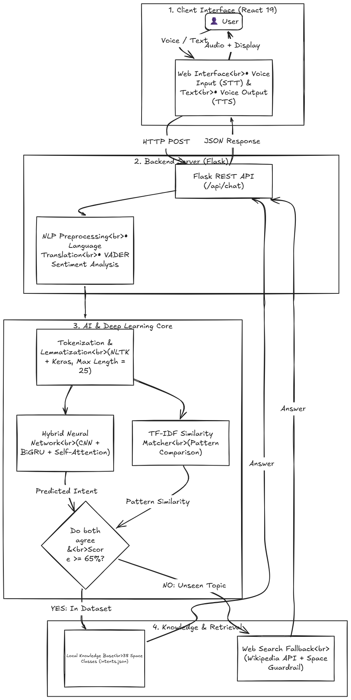

# CosmosBot 🚀 — Voice-Enabled Space & Astronomy Conversational Assistant

An end-to-end, voice-enabled conversational AI system specialized in space exploration, astrophysics, planetary science, and observational astronomy. CosmosBot pairs a modern React 19 glassmorphic interface with a hybrid deep learning engine (**1D CNN + Bidirectional GRU + Multi-Head Self-Attention**) and a grounded dual-agreement knowledge retrieval pipeline.

---

## 🏛️ System Architecture



### Architectural Workflow

The system is structured across four decoupled, modular layers:

1. **Client Interface (React 19 + Vite):**
   - **Speech-to-Text (STT):** Captures user speech in real time with continuous streaming transcriptions via the browser-native Web Speech API.
   - **Text-to-Speech (TTS):** Synthesizes neural responses back to audible speech with language-aware voice matching, pitch, and rate control.
   - **Glassmorphic UI:** Cosmic dark/light modes, animated starfield backdrop, suggestion chips, and responsive layouts across mobile and desktop.
   - **Multimodal Wellness & Tools:** Real-time sentiment tracking with Chart.js mood dashboard, 4-7-8 cosmic guided breathing relaxation, and client-side PDF transcript generation with jsPDF.

2. **Backend API Server (Flask + Gunicorn):**
   - RESTful endpoints (`/api/chat`, `/api/health`, `/api/context/clear`) serving both JSON API requests and the pre-built React Single Page Application.
   - Session context management (`ContextManager`) tracking dialogue state, topic transitions, and follow-up suggestion routing.
   - Multi-language translation engine (`TranslationService`) supporting 12 international and regional languages (English, Hindi, Tamil, Telugu, Spanish, French, German, Japanese, Korean, etc.).
   - Sentiment analysis engine (`SentimentAnalyzer`) using VADER to compute compound emotional valence per turn.

3. **Hybrid Deep Learning & NLP Core:**
   - **Text Preprocessing:** Case normalization, contraction preservation, morphological lemmatization via a lightweight lemma map, Keras tokenization with `<OOV>` handling, and post-padding to $T_{max} = 25$.
   - **Parallel 1D CNNs:** Three parallel convolutional branches with kernel sizes $k \in \{2, 3, 4\}$ (64 filters each) extracting local n-gram motifs (e.g., *"black hole"*, *"James Webb"*, *"escape velocity"*).
   - **Bidirectional GRU (BiGRU):** 64 forward and 64 backward recurrent units (128-dimensional context vector) capturing sequential syntax and long-range dependencies.
   - **Multi-Head Self-Attention:** 4-head scaled dot-product attention dynamically weighting critical astronomical terminology while using Boolean padding masks to ignore padded zeros.
   - **Classification Head:** Residual connection with Layer Normalization, Masked Global Average Pooling, two regularized Dense layers with Dropout (0.4 / 0.3), and a 38-class Softmax distribution.

4. **Dual-Agreement Knowledge Gateway & Space Web Search:**
   - **Anti-Hallucination Gate:** Softmax classifiers can be overconfident on out-of-domain queries. CosmosBot runs a character n-gram (`char_wb` 2–4) TF-IDF matcher in parallel. An intent is accepted **only if both the neural network and TF-IDF matcher agree** and cosine similarity is $\ge 0.65$.
   - **Space-Only Web Search Fallback:** Queries outside the curated 38 intents query the Wikipedia REST API (with DuckDuckGo Instant Answers as backup). Strict keyword guardrails ensure answers are delivered **only for space/astronomy topics** (with source links), while general non-space queries are politely refused ("outside my orbit").

---

## ✨ Features

- 🎤 **Voice Input (STT)** — Browser-native voice recognition with live speech transcription.
- 🔊 **Voice Output (TTS)** — Natural synthesized speech with language matching and toggleable controls.
- 🧠 **Hybrid Neural Network** — 1D CNN + BiGRU + 4-Head Self-Attention for domain intent classification.
- 🎯 **Dual Agreement Scoring** — Match score based on both neural confidence and TF-IDF cosine similarity.
- 🌐 **Space-Only Web Fallback** — Wikipedia and DuckDuckGo integration guarded by space keyword verification.
- 📊 **Mood Analytics Dashboard** — Real-time emotional valence curve and mood distribution powered by Chart.js.
- 🧘 **Cosmic 4-7-8 Breathing** — Guided breathing relaxation modal with expanding/contracting stardust animations.
- 💬 **Contextual Suggestion Chips** — Dynamic follow-up chips based on dialogue context and active topics.
- 📄 **PDF Transcript Export** — Download clean, timestamped chat history with sentiment badges using jsPDF.
- 🔔 **Synthesized Audio** — Procedural audio feedback generated via Web Audio API (no external audio assets).
- 🌓 **Dark / Light Cosmic Theme** — Glassmorphism theme toggle with persistent user preference.
- 🌍 **Multi-Language Support** — Real-time query translation and response localization across 12 languages.

---

## 🛠️ Tech Stack

| Layer | Technologies |
|---|---|
| **Frontend** | React 19, Vite, Vanilla CSS (Glassmorphism & CSS Variables), Chart.js, jsPDF, html2canvas |
| **Backend** | Python 3.11, Flask, Gunicorn (WSGI) |
| **Deep Learning** | TensorFlow / Keras (CNN + BiGRU + Multi-Head Attention), Scikit-Learn |
| **NLP & Analysis**| NLTK, VADER Sentiment, Character n-gram TF-IDF Vectorizer, Googletrans |
| **APIs & Search** | Wikipedia REST API, DuckDuckGo Instant Answer API |
| **Browser APIs** | Web Speech API (`SpeechRecognition`, `SpeechSynthesis`), Web Audio API |

---

## 📁 Repository Structure

```
nlp-chatbot/
├── backend/
│   ├── app.py                     # Flask REST API server and SPA static file host
│   ├── chatbot_engine.py          # Dual-agreement inference engine (TF-IDF + Neural)
│   ├── context_manager.py         # In-memory session tracking & topic follow-ups
│   ├── intent_matcher.py          # TF-IDF pattern similarity matcher
│   ├── lemma_dict.json            # Zero-overhead lemmatization dictionary
│   ├── sentiment_analyzer.py      # VADER sentiment analysis engine
│   ├── translation_service.py     # 12-language translation pipeline
│   ├── web_search.py              # Wikipedia & DuckDuckGo space-guarded search
│   └── __init__.py
├── data/
│   └── intents.json               # 38 space exploration intents & response patterns
├── docs/
│   └── report.md                  # Comprehensive academic lab assessment report
├── frontend/
│   ├── dist/                      # Production build bundle served by Flask
│   ├── src/
│   │   ├── components/            # Header, MessageItem, InputArea, BreathingModal, MoodModal, etc.
│   │   ├── services/              # Web Audio soundService, Web Speech speechService, exportService
│   │   ├── styles/                # Glassmorphic themes.css and animations.css
│   │   ├── App.jsx                # Root React component orchestrating UI state
│   │   ├── App.css                # Component and layout stylesheet
│   │   └── main.jsx               # React entry point
│   ├── package.json               # Frontend dependencies (React 19, Vite, Chart.js, jsPDF)
│   └── vite.config.js             # Vite configuration with local proxy to localhost:5000
├── model/
│   ├── chatbot_model.keras        # Trained neural network model weights
│   ├── label_encoder.pickle       # Pickled 38-class intent label encoder
│   ├── tokenizer.pickle           # Pickled vocabulary tokenizer
│   ├── model_config.json          # Architecture configuration metadata
│   ├── training_history.json      # Training loss/accuracy metrics per epoch
│   ├── model_architecture.py      # Keras Functional API model definition
│   ├── preprocessing.py           # Text cleaning, lemmatization, and padding pipeline
│   └── train.py                   # Two-phase training pipeline with data augmentation
├── tests/
│   └── smoke_test.py              # Automated test suite for intent routing and search guardrails
├── chatbot_architecture.png       # End-to-end system architecture diagram
├── Procfile                       # Production web worker configuration for Render/Heroku
├── render.yaml                    # Infrastructure-as-code deployment blueprint
├── requirements.txt               # Python package dependencies
├── runtime.txt                    # Python runtime specification (python-3.11.9)
└── README.md                      # Project documentation
```

---

## 🚀 Setup & Execution Guide

### Prerequisites
- Python 3.11+
- Node.js 18+ and npm

---

### 1. Backend Setup

```bash
# Clone the repository
git clone https://github.com/KV225511/nlp-chatbot.git
cd nlp-chatbot

# Create and activate a Python virtual environment
# On Windows (PowerShell):
python -m venv venv
.\venv\Scripts\Activate.ps1

# On Linux / macOS:
python3 -m venv venv
source venv/bin/activate

# Install Python dependencies
pip install -r requirements.txt

# (Optional) Retrain the deep learning model:
python model/train.py

# Launch the backend server:
python backend/app.py
```
The server will start at `http://localhost:5000`. When accessed directly in a browser, Flask serves the pre-built React frontend from `frontend/dist`!

---

### 2. Frontend Development

To run the React development server with hot-module reloading (HMR) and automatic backend proxying:

```bash
cd frontend
npm install
npm run dev
```
Open `http://localhost:5173` in your browser. Requests to `/api/*` are automatically forwarded to `http://localhost:5000`.

To build the production bundle for deployment:
```bash
npm run build
```

---

### 3. Automated Smoke Tests

Verify that neural predictions, the dual-agreement gate, and web search space guardrails are functioning correctly:

```bash
python tests/smoke_test.py
```

Expected output:
```
[PASS] dataset  'Tell me about black holes' -> black_holes (1.00)
[PASS] dataset  'Tell me about Apollo 11' -> space_exploration_history (0.81)
[PASS] dataset  'What is the speed of light' -> light_speed (1.00)
[PASS] dataset  'speed of light' -> light_speed (0.90)
[PASS] dataset  'How do rockets work' -> rocket_science (1.00)
[PASS] dataset  'how big is jupiter' -> jupiter_facts (1.00)
[PASS] dataset  'Hello' -> greeting (1.00)
[PASS] dataset  'Thanks' -> thanks (1.00)
[PASS] unknown  'What is ISRO' -> is_known=False
[PASS] unknown  'What is Chandrayaan 3' -> is_known=False
[PASS] unknown  'Who is Kalpana Chawla' -> is_known=False
[PASS] unknown  'What is the capital of France' -> is_known=False
[PASS] unknown  'asdkjhfaskjdfh' -> is_known=False
[PASS] web      'What is ISRO?' -> ISRO
[PASS] web      'Tell me about Chandrayaan 3' -> Chandrayaan-3
[PASS] off-topic 'What is the capital of France' -> refused
[PASS] off-topic 'Who is Elon Musk' -> refused
[PASS] off-topic 'recipe for pasta' -> refused
[PASS] off-topic 'what is bitcoin' -> refused
[PASS] no-web   'ok cool'
[PASS] no-web   'lol'

✅ All smoke checks passed
```

---

## ⚙️ Configuration & Environment Variables

| Variable | Default | Purpose |
|---|---|---|
| `PORT` | `5000` | HTTP port for Flask / Gunicorn |
| `CORS_ORIGINS` | `*` | Allowed CORS origins (e.g. `https://your-app.vercel.app` or `*`) |
| `WEB_SEARCH_ENABLED` | `true` | Enable or disable external Wikipedia / DuckDuckGo fallback |
| `WEB_SEARCH_TIMEOUT` | `6` | Timeout limit in seconds per external web request |
| `FLASK_DEBUG` | `false` | Enable Flask debug mode (leave `false` in production) |
| `VITE_API_URL` | *(empty)* | Frontend API base URL (leave empty for local dev proxy; set to backend URL on Vercel) |

---

## ☁️ Deployment

### Render (Full-Stack or Backend Service)
1. Link your GitHub repository to [Render](https://render.com).
2. Create a new **Web Service** with:
   - **Environment:** `Python`
   - **Build Command:** `pip install -r requirements.txt && cd frontend && npm install && npm run build && cd ..`
   - **Start Command:** `gunicorn backend.app:app --bind 0.0.0.0:$PORT --timeout 120 --workers 1`
3. Memory consumption stays under **370 MB**, fitting comfortably within Render's free tier (512 MB).

### Vercel (Frontend Static Host)
If hosting the React frontend separately on Vercel:
1. Root Directory: `frontend`
2. Build Command: `npm run build`
3. Output Directory: `dist`
4. Set Environment Variable: `VITE_API_URL = https://your-backend.onrender.com`

---

## 📜 License

This project is licensed under the MIT License.
